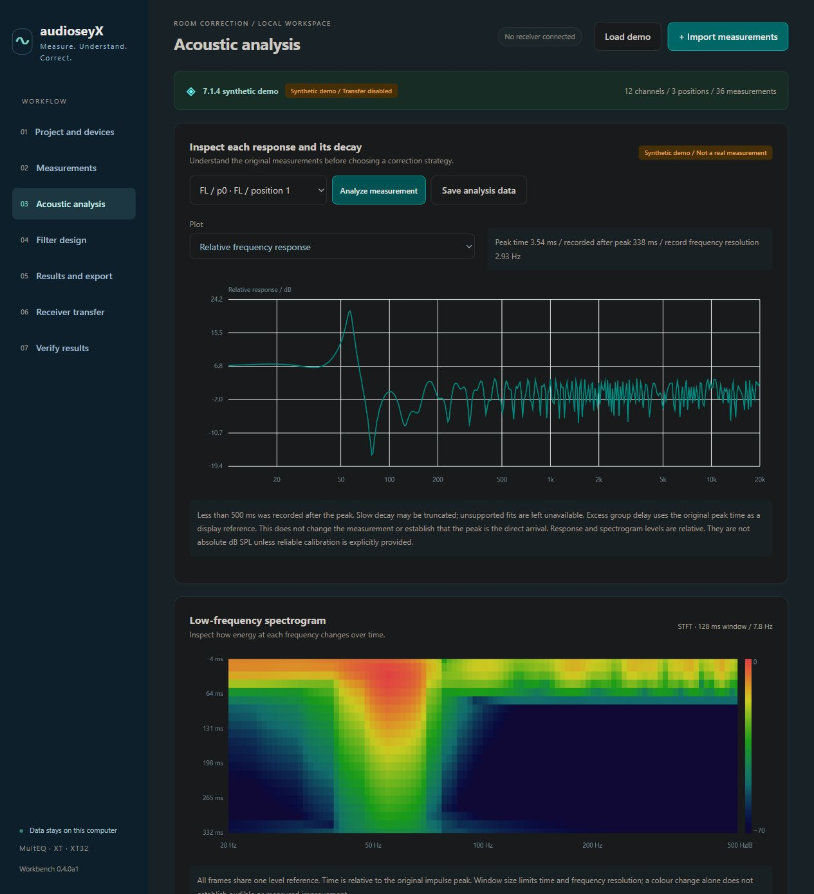

# Quick start

## Install this checkout

Use Python 3.11 or newer in a virtual environment:

```console
python -m venv .venv
python -m pip install .
audioseyx
```

Activate `.venv` using your shell's normal activation command before installation. Until an actual PyPI release exists, use a local checkout or a locally built wheel. Once a prerelease is published, `python -m pip install --pre audioseyX` will install it.

`audioseyx` opens the local interface in your browser. `python -m audioseyx` is equivalent. No external web server or receiver is needed to explore the demo.

## Try the demo

1. Select **Load demo**. It contains 12 channels, three positions and 36 synthetic responses.
2. Open **Acoustic analysis**, select a measurement, then choose **Analyze measurement**.
3. Inspect relative response, group delay, impulse, ETC, decay and the low-frequency spectrogram.
4. Open **Filter design**, select a tier and run the design.
5. Review **Results and export** and save the design bundle.

Synthetic data are marked throughout the workflow and cannot be transferred as real receiver calibration. Missing native compatibility data do not prevent filter WAV export.



## User data and command-line options

Python installations use the operating system's per-user application-data directory. Windows portable builds use `UserData` beside the executable. Select your own directory with:

```console
audioseyx --data-dir ./projects
audioseyx --no-browser --port 8768
audioseyx --self-test --report self-test.json
audioseyx --compat-status
```

Use **Exit workbench** to stop the service. An active capture must be stopped, and an active receiver transfer must finish, before exiting.

## Existing 0.3 projects

The `.awb` and project JSON formats retain their existing schema identifiers. Import an earlier project instead of copying a live data directory. Native numerical resources from the private research prototype are not part of the public installation.
